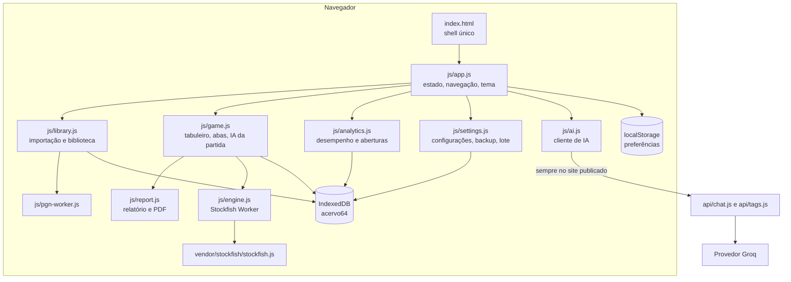
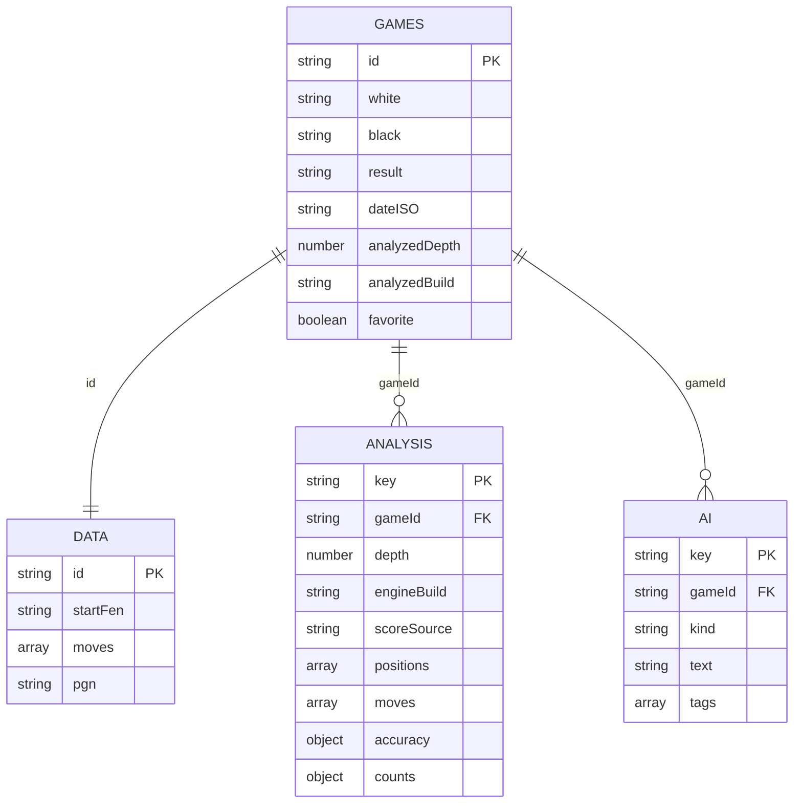
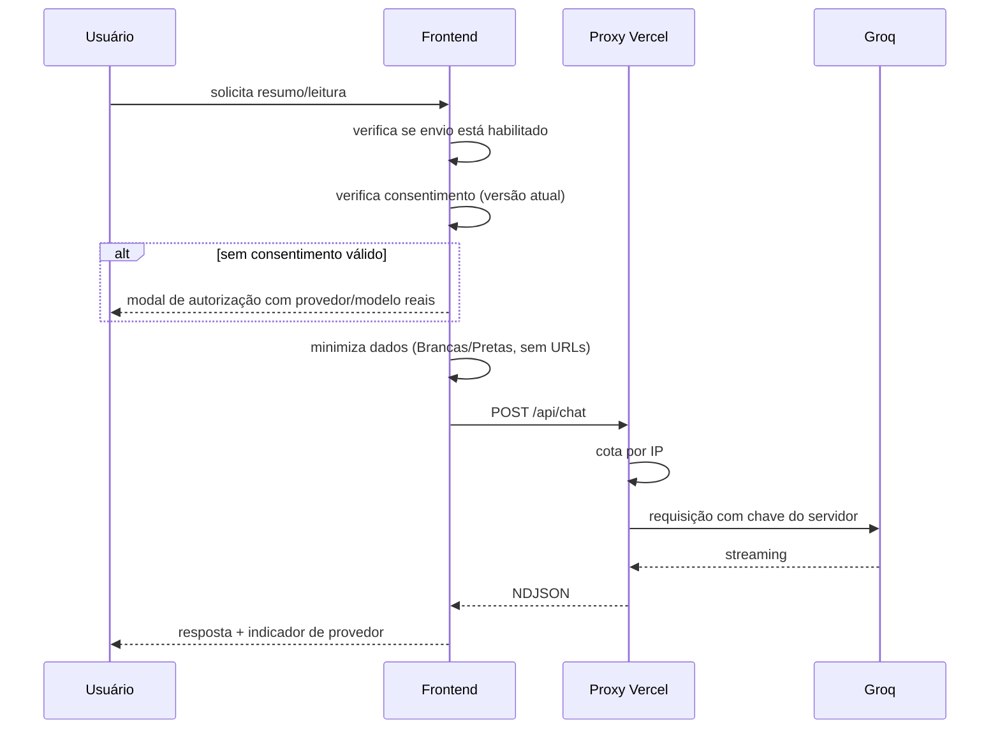

# Arquitetura e integração — Chess-Analysis

**Versão do documento:** 1.0 — Fase 1  
**Atualizado em:** 16/11/2026  
**Estado:** implementação incremental; o shell atual ainda é uma única página HTML.

---

## 1. Decisão arquitetural

**Decisão aprovada:** arquitetura multipágina com arquivos HTML convencionais,
módulos JavaScript compartilhados, checkpoints persistentes e retomada
confiável.

Regras:

- Não transformar o aplicativo em SPA.
- Não depender da sobrevivência de Web Workers entre páginas.
- Persistir progresso no IndexedDB após unidades verificáveis de trabalho.
- A navegação usa URLs convencionais e é compatível com a Vercel.
- A Fase 1 estabiliza o shell atual; a separação física das páginas é feita em
  etapa controlada, com testes entre cada extração.

### 1.1. O que acontece ao trocar de página

1. A página atual pode solicitar parada organizada do Worker.
2. O último checkpoint consistente já está no IndexedDB.
3. A nova página abre um novo contexto e não herda o Worker anterior.
4. A fila persistida é carregada e tarefas interrompidas são identificadas.
5. O processamento só é retomado quando o usuário confirma ou quando a política
   da tarefa permitir.

### 1.2. Limitações assumidas

- O navegador não continua processando depois de fechado.
- Um Worker não sobrevive a recarregamento, navegação ou fechamento da aba.
- Um pequeno trecho ainda não confirmado no checkpoint pode ser recalculado.
- Tarefas interrompidas nunca são marcadas como concluídas.

---

## 2. Arquitetura atual (Fase 1)

### 2.1. Módulos atuais

| Módulo | Responsabilidade | Dependências principais |
|---|---|---|
| `js/app.js` | estado global, utilidades, navegação, tema, modais, inicialização | todos os módulos de página |
| `js/storage.js` | IndexedDB e preferências | navegador |
| `js/pgn.js` | parser e serializador PGN | chess.js |
| `js/pgn-worker.js` | leitura de PGN fora da thread principal | chess.js, pgn.js |
| `js/engine.js` | Stockfish, avaliações, anotações e precisão | Worker, chess.js |
| `js/board.js` | renderização do tabuleiro | SVGs de peças |
| `js/library.js` | importação, filtros, tabela, exportação | DB, PGN, Openings, Tags |
| `js/game.js` | partida, abas, análise, tags, entrada do relatório | DB, Engine, AI, Board |
| `js/report.js` | relatório detalhado e PDF via impressão | Engine (rótulos), chess.js (PV em SAN) |
| `js/analytics.js` | estatísticas, aberturas, leitura, repertório | DB, Stats, AI |
| `js/settings.js` | configurações, backup, restauração, lote | DB, Settings, AI |
| `js/openings.js` | reconhecimento de aberturas | base ECO local |
| `js/tags.js` | tags fixas por lado | análise e partida |
| `js/stats.js` | identidade provisória e cálculos | partidas |
| `js/ai.js` | cliente de IA, privacidade e prompts | proxy `/api/*` |

### 2.2. Módulos previstos para a separação multipágina

| Página | Responsabilidade | Estado |
|---|---|---|
| `index.html` | dashboard inicial | Planejada |
| `biblioteca.html` | bibliotecas e importação | Planejada |
| `lances.html` | tabuleiro e histórico | Planejada |
| `analise.html` | Stockfish e classificações | Planejada |
| `desempenho.html` | estatísticas | Planejada |
| `central-analises.html` | fila e processamento | Planejada (Fase 3) |
| `assistente-ia.html` | Treinador IA | Planejada |
| `configuracoes.html` | preferências e privacidade | Planejada |

A separação só avança depois que a Fase 1 estiver estável e testada.

---

## 3. Navegação principal

A interface deve expor cinco áreas:

1. **Biblioteca** — importação, lista, filtros, exportação e entrada para análise
   em lote.
2. **Análise** — tabuleiro, lances, avaliação, classificações e IA da partida.
3. **Desempenho** — estatísticas; Aberturas é uma página auxiliar acessível por
   botão, sem ocupar o menu principal.
4. **Treinador IA** — leitura do acervo, repertório e privacidade.
5. **Configurações** — perfil, motor, IA, backup e dados.

Regras de navegação:

- Avançar ou retroceder lances **não altera** a aba Lances/Análise/IA.
- Abrir uma partida pode selecionar a aba Lances (comportamento esperado).
- O botão ativo usa `aria-current="page"`.
- A central de análises será acessível pela Biblioteca e pelo indicador de
  processamento.

---

## 4. Armazenamento

### 4.1. IndexedDB

- Banco legado: `acervo64` (preservado para não perder dados).
- Versão: `1`.
- Repositório central: `js/storage.js`.

### 4.2. Preferências

- Chave: `acervo64_settings_v1`.
- Mantida para compatibilidade.
- Novas opções de privacidade serão adicionadas com valores padrão seguros.

### 4.3. Migrações

- Nenhuma migração destrutiva na Fase 1.
- `DB.VERSION` continua `1`.
- Se uma versão futura exigir mudança de schema, será criada migração
  transacional com backup prévio e verificação de contagem.

---

## 5. Workers

| Worker | Entrada | Saída | Fallback |
|---|---|---|---|
| `js/pgn-worker.js` | texto PGN + nome do arquivo | partidas validadas + erros | leitura na thread principal |
| Stockfish | comandos UCI | linhas `info` e `bestmove` | nenhum; análise exige HTTP(S) |

### 5.1. Regras

- O Worker de PGN é reaproveitado entre arquivos.
- Uma falha isolada não invalida o Worker para os próximos arquivos.
- O Stockfish tem timeout de inicialização e de busca.
- `Engine.stop()` encerra o Worker e limpa a promessa de inicialização.

---

## 6. Stockfish e classificação

### 6.1. Integração

- Distribuição atual: `vendor/stockfish/stockfish-19-lite-single.js` +
  `.wasm` (Stockfish 19 Lite WASM, release v19.0.1).
- **Identidade estável do build:** `Engine.BUILD_ID = 'stockfish-19-lite-single'`.
  O `id name` do UCI continua em `analysis.engineId` para exibição, mas **não**
  serve de chave: muda entre releases. O build é gravado em `engineBuild` e
  entra na chave de armazenamento (`gameId@depth@build`).
- Protocolo UCI, `Hash=32`, `MultiPV=1`, `UCI_ShowWDL=true`.
- Análise por profundidade, com progresso por posição.
- Avaliações convertidas em Win% e perda em pontos percentuais.
- **WDL:** capturado em `positions[i].wdl` (por-mil) e **usado no Expected
  Score** quando a cobertura é completa — `(w + d/2)/10`, `version: 3`,
  `scoreSource: 'wdl'`. Se faltar WDL em alguma posição avaliada, a análise
  inteira cai para a curva sobre `cp` (`version: 2`). A fonte nunca é misturada
  por posição.
- **Posições terminais:** `Engine.terminalResult` valida a FEN com a chess.js
  (um rei de cada lado), grava `mate: 0` no xeque-mate e `cp: 0` no afogamento
  ou material insuficiente, sem consultar o Worker. `depth 0` do motor só é
  aceito quando a terminalidade já foi confirmada — ele também aparece em FEN
  inválida. Terminais são isentas da exigência de WDL e o `mate` tem prioridade
  sobre as duas fontes.
- **Par JS/WASM:** o bundle deriva o binário do próprio nome
  (`stockfish-19-lite-single.js` → `.wasm`). Renomear um sem o outro quebra o
  motor.
- A validação de terminalidade roda **somente no navegador**; nenhuma Function
  da Vercel importa `chess.js`.
- Evidências de execução: [`docs/TESTES-FASE-2.md`](TESTES-FASE-2.md).

### 6.2. Classificações

O motor classifica em dez categorias: Brilhante, Grande Lance, Melhor,
Excelente, Bom, Livro, Imprecisão, Erro, Chance Perdida e Erro Grosseiro. As
regras e os limites percentuais estão documentados em
[`MODELO-DE-DADOS.md`](MODELO-DE-DADOS.md#3-classificações-de-movimento).
MultiPV 2 fornece a segunda opção da posição; o catálogo ECO local verifica o
prefixo completo até cada lance. `classificationVersion` permite reconstruir
classificações anteriores sem alterar as avaliações salvas.

A ordem visual não implica escala linear.

---

## 7. IA e privacidade

### 7.1. Fluxo

### 7.2. Regras

- A chave nunca vai ao navegador.
- O consentimento é solicitado antes do primeiro envio externo.
- “Não enviar dados à IA” bloqueia chamadas e mantém biblioteca, Stockfish e
  estatísticas funcionando.
- Nomes reais, usernames, URLs e localização não são enviados quando
  desnecessários.
- O proxy registra apenas provedor, modelo e status HTTP; não registra prompts,
  respostas, chaves nem `error.message` de infraestrutura.
- Erros 401, 429, 503, timeout e rede têm mensagens próprias.
- `/api/tags` valida a credencial do provedor antes de dizer “online”.
- O teto de tokens de saída vem de `AI_MAX_TOKENS` (servidor); o navegador não
  escolhe esse valor.
- A versão do consentimento (`2026-11-17-v2`) invalida autorizações dadas sob o
  texto antigo, que identificava outro provedor.

### 7.3. Provedor implementado

Configuração oficial desde 17/11/2026:

- Provedor: **Groq**.
- Base: `https://api.groq.com/openai/v1`.
- Modelo: `openai/gpt-oss-120b`.
- Variáveis: `AI_PROVIDER=openai`, `AI_BASE_URL`, `AI_MODEL`, `AI_API_KEY`,
  `AI_MAX_TOKENS` (padrão 4096; faixa 256–32768).
- `AI_ACCESS_MODE` e `AI_ACCESS_CODES` não fazem parte do fluxo; são variáveis
  históricas da Vercel, sem referência no código, e podem ser removidas
  manualmente. `AMIGO_1` era um código de acesso individual da versão anterior
  e também é histórica.
- Sem chave real configurada, a interface informa que o Treinador IA está
  indisponível; não simula resposta.
- A política de privacidade exibida é a do provedor identificado em
  `/api/tags` (`https://groq.com/privacy-policy`). Ela cobre o tratamento do
  provedor; não descreve o armazenamento local do aplicativo.
- Em produção, `GET /api/tags` confirmou `api.groq.com` e
  `openai/gpt-oss-120b`; uma chamada fictícia de `/api/chat` devolveu HTTP 200
  em NDJSON (ver `TESTES-FASE-2.md` §12).

---

## 8. APIs da Vercel

| Rota | Método | Função | Estado |
|---|---|---|---|
| `/api/chat` | POST | conversa em streaming | Implementada; validação de corpo, cota por IP e tradução de erros |
| `/api/tags` | GET | status e modelos | Implementada; valida a credencial real em `/models` |

Headers de segurança atuais: `X-Content-Type-Options`, `Referrer-Policy`,
`X-Frame-Options`, `Permissions-Policy`. CSP será avaliada somente depois de
teste local e em produção.

---

## 9. Central de Análises (Fase 3)

Planejado:

- fila persistente por partida;
- estados: pendente, processando, pausada, interrompida, concluída, cancelada,
  erro;
- checkpoint após cada posição ou grupo verificável;
- retomada após recarregar/navegar;
- um motor simultâneo por padrão;
- indicador real de progresso;
- coordenação entre abas.

Não implementar antecipadamente na Fase 1. O botão de análise em lote existente
é apenas o ponto de entrada provisório.

---

## 10. Testes

| Tipo | Ferramenta | Estado |
|---|---|---|
| Sintaxe | `tools/check-syntax.cjs` | Executado: todos os arquivos válidos |
| API/regras | `node --test tests/` | Executado: **30 testes aprovados** (17/11/2026) |
| Fumaça no navegador | Edge headless + CDP | Executado: importação, partida, abas, relatório |
| Análise real | Edge headless + Stockfish 19 | Executado em profundidade 6 e 12, com mate |
| PDF | Edge `--print-to-pdf` | Executado: PDF de 3 páginas |
| Backups | Edge headless + CDP | Executado com exemplos: exportar → limpar → restaurar → backup prévio |
| IA em produção | HTTP + `/api/tags` e `/api/chat` | Executado: Groq, `openai/gpt-oss-120b`, NDJSON |
| Deploy das correções | Vercel CLI + HTTP | **Não executado** — bloqueado por proveniência |

Evidências em `docs/TESTES-FASE-1.md`. Nenhum teste é declarado aprovado sem
execução.

---

## 11. Estados de implementação

| Item | Estado |
|---|---|
| Auditoria inicial | Implementada e documentada |
| Linha de base e cópia do código | Implementada e verificada |
| Identidade “Chess-Analysis” | Implementada na Fase 1 |
| Remoção do dropzone | Implementada na Fase 1 |
| Remoção do código de acesso | Implementada na Fase 1 |
| Cinco áreas de navegação | Implementada na Fase 1 |
| Correção da IA/Groq | Implementada e validada em produção (`/api/tags` + uma chamada fictícia); correções locais ainda **não** publicadas |
| Consentimento e minimização | Implementados; versão `2026-11-17-v2` exige novo aviso |
| PDF robusto | Implementado e testado com análise real |
| `PlayerIdentity` | Contrato documentado; implementação na Fase 5 |
| Stockfish 19/WDL | Implementado e testado (profundidade 6 e 12) |
| Terminalidade (`depth 0`) | Corrigida e testada; `mate: 0` preservado |
| Proveniência das análises | **Resolvida na Tarefa 2** (chave com build, migração, aviso, v3); deploy não executado |
| 10 categorias de classificação | Implementadas (limiares, MultiPV 2 e prefixos do catálogo ECO) |
| Central de Análises | Planejada para a Fase 3 |
| Chess.com/Lichess | Planejado para a Fase 4 |

---

## 12. Riscos arquiteturais

1. O shell único atual concentra estado global; a extração multipágina exige
   cuidado com dependências circulares.
2. A ausência de módulos ES na base atual dificulta testes unitários puros.
3. O parser não preserva variantes/comentários; relatórios e IA não podem
   exibi-los sem mudança de modelo.
4. A identidade provisória pode atribuir partidas incorretamente; a Fase 5 deve
   corrigir com `PlayerIdentity`.
5. A IA em produção usa Groq com chave válida; o `.env` local tem chave
   placebo, então a validação local ponta a ponta continua impossível.
6. Sem backup real exportado, nenhuma migração de dados pode avançar.
7. **Proveniência (resolvida):** `analysis` passou a ser indexada por
   `gameId@depth@build`; a forma legada `gameId@depth` continua válida e é
   lida com aviso quando não há registro do build atual. `getAnalysis` prefere
   o build atual e as estatísticas excluem médias de outro motor
   (`stats.otherEngine`). Resta o backup real do usuário antes de qualquer
   deploy.
